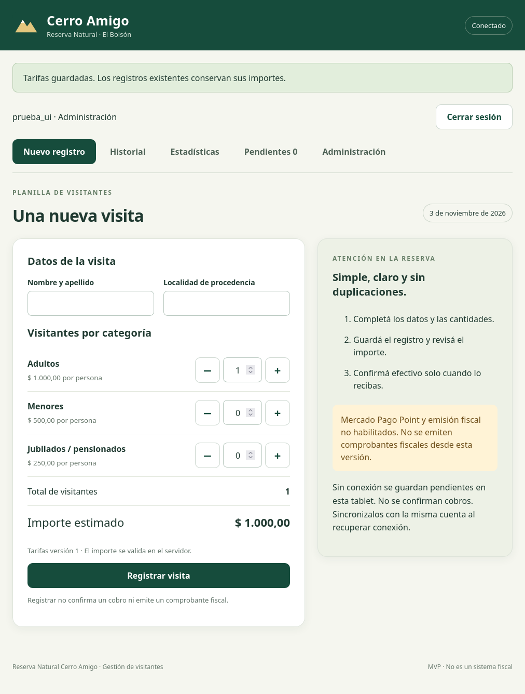

# Cerro Amigo · Gestión de visitantes

MVP local para la Reserva Natural Cerro Amigo, El Bolsón. Basado en la planilla aportada por Mora. **No desplegado en producción. No integra todavía Mercado Pago ni controlador fiscal.**

## Incluye
- Interfaz táctil responsive, manifiesto PWA y shell sin conexión.
- Registro de grupos: fecha automática, nombre, localidad, adultos, menores y jubilados/pensionados. Cantidad total e importe separados.
- Tarifas configurables por administrador, versionadas; importes históricos en centavos ARS.
- Usuarios/roles, sesiones con cookie HttpOnly, CSRF y contraseñas scrypt. Sin cuenta ni contraseña predeterminada.
- Historial paginado, búsqueda, corrección de nombre/localidad con motivo, anulación de registros **sin pago** y auditoría.
- Cobro manual en efectivo con confirmación explícita; registro, pago y fiscal independientes.
- Estadísticas por día/mes de visita, procedencia, categoría y medio. Cobrado ≠ esperado. No es un cierre de caja por fecha de cobro.
- CSV UTF-8 compatible con Excel, con neutralización de fórmulas. No genera archivos XLSX nativos.
- Pendientes locales con UUID y sincronización manual idempotente. Nunca confirma pago/fiscal offline.
- Respaldo SQLite consistente y prueba de restauración.

## Inicio local
Requisito: **Node.js 24 LTS actualizado**, con SQLite nativo. No necesita instalar paquetes npm. SQLite puede mostrar advertencias según la versión menor de Node.

Desde la carpeta del repositorio:

```sh
npm run admin -- administrador
npm start
```

El primer comando solicita una contraseña de al menos 12 caracteres sin mostrarla. Abrí **http://127.0.0.1:3080** e ingresá con la cuenta creada. En Administración, cargá primero las **tarifas oficiales**; los ceros iniciales no están habilitados para registrar visitas. Creá cuentas individuales de operador. No usar datos reales antes de autorizar el piloto y definir protección/retención.

Variables opcionales (configurarlas en el entorno; no se carga .env automáticamente):

| Variable | Por defecto | Uso |
|---|---|---|
| HOST | 127.0.0.1 | Interfaz local, no expuesta a la red |
| PORT | 3080 | Puerto HTTP |
| APP_ORIGIN | http://127.0.0.1:3080 | Origen exacto del navegador; actualizar si cambia puerto/host |
| DB_PATH | ./data/cerro-amigo.sqlite | Base persistente; ruta relativa al directorio de ejecución |

Para otra computadora/tablet se requiere configurar y autorizar un servidor con **HTTPS**, origen exacto y proxy de confianza; la app debe seguir en loopback detrás del proxy. No se entrega configuración de producción aplicada. No exponer HTTP plano en una red compartida. Con APP_ORIGIN HTTPS la cookie se emite Secure. El proxy debe preservar Origin y limitar solicitudes/cuerpo; no se confía en X-Forwarded-For (el límite de login es conservador y compartido detrás de proxy).

En Android/Chrome: acceder por HTTPS y usar «Instalar aplicación» / «Añadir a pantalla de inicio» según navegador. iPad/Safari: Compartir → Añadir a pantalla de inicio. Instalación y uso físico en tablet aún requieren validación en el equipo de destino.

## Operación
1. Registrar una visita. El total se recalcula en servidor; no confiar en el importe del cliente.
2. En el detalle, confirmar efectivo **solo después de recibirlo**. Repetir la solicitud no duplica el cobro.
3. Ver historial por período. Administrador puede exportar CSV: Excel → Datos → Desde texto/CSV → UTF-8 → separador punto y coma; importes decimales con punto.
4. Correcciones de nombre/localidad requieren motivo. Para cantidades equivocadas, anular y registrar otra visita únicamente antes del cobro. Pagos ya confirmados requieren un procedimiento de corrección/reembolso aún no implementado. No editar la base directamente para arreglar ventas.
5. Revisar pendientes antes de finalizar la jornada. Sincronizar con la misma cuenta/tablet. No borrar almacenamiento del navegador.

Offline: mantener abierta una sesión ya iniciada y tarifas cargadas. Se conserva la cola al recargar, pero hace falta recuperar conexión para autenticar de nuevo. Si cambia una tarifa, revisar el nuevo importe antes de reenviar. Pendientes >30 días requieren resolución supervisada; no cambiar fechas para forzar su ingreso. Una sola pestaña activa por cuenta/tablet en este MVP. El almacenamiento local contiene nombres/localidades sin cifrado adicional: tablet exclusiva con bloqueo y cifrado; nunca usar equipos compartidos con el público. No se hace login ni se confirma efectivo/fiscal sin servidor.

## Respaldos y recuperación
```sh
npm run backup
# Destino específico nuevo (no sobrescribe):
npm run backup -- /ruta/segura/respaldo.sqlite
```

Usa la API de respaldo SQLite, no copia a ciegas un archivo en modo WAL. Verifica integrity_check. Copiar el resultado a almacenamiento externo **cifrado** con accesos restringidos; incluye información personal y hashes/sesiones. Restringir permisos también en ese destino. Rotación y periodicidad pendientes de decisión; no hay automatizaciones activadas.

Restaurar: detener esta app de forma controlada, conservar una copia del estado actual, colocar el respaldo en una **ruta nueva** y apuntar DB_PATH a esa ruta. No mezclar con archivos -wal/-shm antiguos ni sobrescribir la base en uso. Antes de reabrir, eliminar las sesiones restauradas desde una herramienta SQLite autorizada (DELETE FROM sessions), para que todos deban iniciar sesión nuevamente. Verificar integridad, cantidades, tarifas y un login. Las pruebas automatizadas verifican lectura de registros y auditoría de un respaldo restaurado.

Recuperación local de cuenta (solo operador del servidor autorizado):
```sh
npm run admin -- administrador --reset
```
Restablece contraseña, reactiva la cuenta e invalida sus sesiones; no cambia su rol. El evento queda auditado. Administradores pueden deshabilitar/habilitar otras cuentas desde la interfaz. El endpoint administrativo permite también restablecer contraseñas, pero esta versión no ofrece todavía ese formulario en pantalla.

## Verificación
```sh
npm run check
npm test
```
Pruebas con datos sintéticos y DB temporaria: autenticación, roles/CSRF/origen, tarifas/concurrencia, idempotencia, efectivo, validación, edición/anulación, CSV seguro, estadísticas, persistencia, respaldo/restauración y aislamiento de recursos privados. No prueban integraciones externas ni sustituyen auditoría de seguridad o piloto físico.

Prueba visual opcional, con Python 3 y Firefox ya instalados: `python3 scripts/ui-smoke.py`. Ver [evidencia y límites de las pruebas](docs/PRUEBAS.md). Para publicar futuras versiones, incrementar el nombre de caché en `public/sw.js` cuando cambie el shell, y validar la actualización sin perder pendientes.



## Pendientes y límites
Ver [análisis y fases](docs/ANALISIS.md). Se requieren tarifas/reglas oficiales, hardware de Point/controlador, requisitos fiscales, infraestructura HTTPS y validación física. No hay devoluciones, cierres de caja, fiscal, cobros online ni conciliación Point. Auditoría a nivel aplicación, no libro inmutable frente a administradores del servidor. Retención y borrado de datos personales deben definirse antes del uso real. Probar carga con el número real de tablets. Sin SLA de producción.

Código sin dependencias npm externas. No se incluyeron secretos, DB reales ni datos de visitantes en Git. El PDF original queda fuera del repositorio; sus campos se documentan en el análisis.
